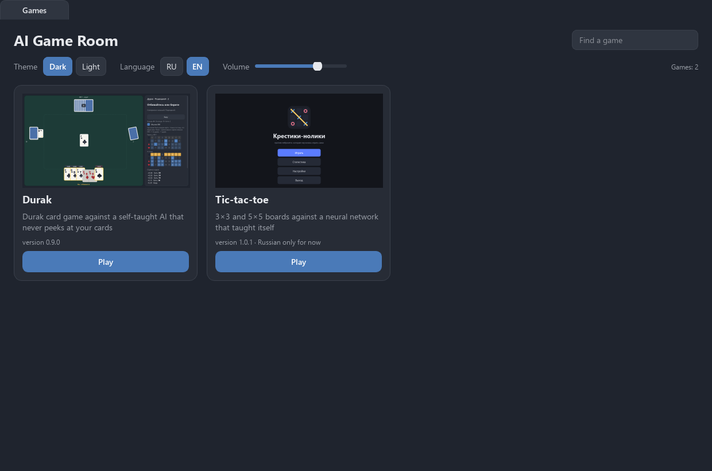
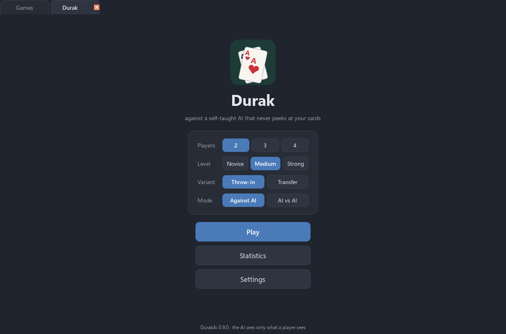

<div align="center">

# AI Game Room

**One window for games against AI that taught itself: Durak, tic-tac-toe and more to come. Every game opens in its own tab; theme, language and sound are shared.**

[Русская версия](README.ru.md)

[](#) [](https://github.com/ALEXalesha/AiGameRoom/actions/workflows/ci.yml) [](LICENSE) [](https://www.python.org/) [](https://doc.qt.io/qtforpython-6/) [](https://claude.com/claude-code)

Code, tests and docs are written by Claude (Anthropic) in Claude Code. Ideas, testing and decisions - Alexey.



</div>

**Status:** version 0.1.0, not released yet. The 1.0 release comes once all the games are inside; until then run it from source (see Run).

Each game is developed in its own repository and follows one contract
([docs/contract.md](docs/contract.md)): a `game/` package with `GAME_INFO` and
`create_widget(ctx)`. AI Game Room is the shell that collects these games in one program.

## Features

- **Home tab** with a card per game: preview, description, version, search. A game that fails
  to load stays in the list with the reason; the shell keeps working.
- **Each game in a tab.** Open several at once; a hidden tab is paused, a closed tab stops the
  game's threads within 2 seconds and frees its memory.
- **Shared settings:** Paint themes (dark and light), Russian and English, volume. Changing them
  in the shell or inside any game reaches every open game.
- **Shared statistics:** every card shows games played, wins and the best winning streak; the
  header shows the total over all games.
- The window reopens where it was closed.
- Python, PySide6 and numpy only. No pygame.



## Games

| Game | Version | Source |
|---|---|---|
| Durak | 1.0.5 | DurakAi |
| Tic-tac-toe | 1.0.1 | TicTacToeAi (Russian only for now) |
| Rock paper scissors | 1.0.4 | RockPaperAi |
| Neuro Snake | 2.0.0 | SnakeAi |

More games join as they reach 1.0: 2048, falling blocks, checkers and chess, battleship,
minesweeper and others.

## Run

```
pip install -r requirements.txt
python main.py                  # the shell
python main.py --game durak     # open a game right away
python main.py --list           # games found and why a game did not load
python main.py --selftest out.txt
```

## How a game joins

```
python tools/vendor_game.py durak                   # copy a game into games/durak/
python tools/contract_check.py ../SomeGame --run    # check a game folder against the contract
```

Games live as copies in `games/<id>/`: every game calls its package `game`, and two packages
with the same name cannot live in one program, so the copy tool rewrites the imports.
Details: [docs/games.md](docs/games.md).

## Build

```
pip install pyinstaller pillow
python build.py                 # dist/AiGameRoom, portable zip and an NSIS installer
```

One Python and one Qt for all games: the folder is about 150 MB, the installer about 45 MB,
the games themselves under 2 MB.

## Tests

```
pip install -r requirements-dev.txt
python -m pytest -q             # without a screen (Qt offscreen)
python tools/mutate.py          # breaks the shell on purpose; every mutant must be caught
```

Every game in `games/` is opened and closed in the tests: no errors, no leaked widgets or
threads, no memory growth over repeated open/close.

## License

MIT
