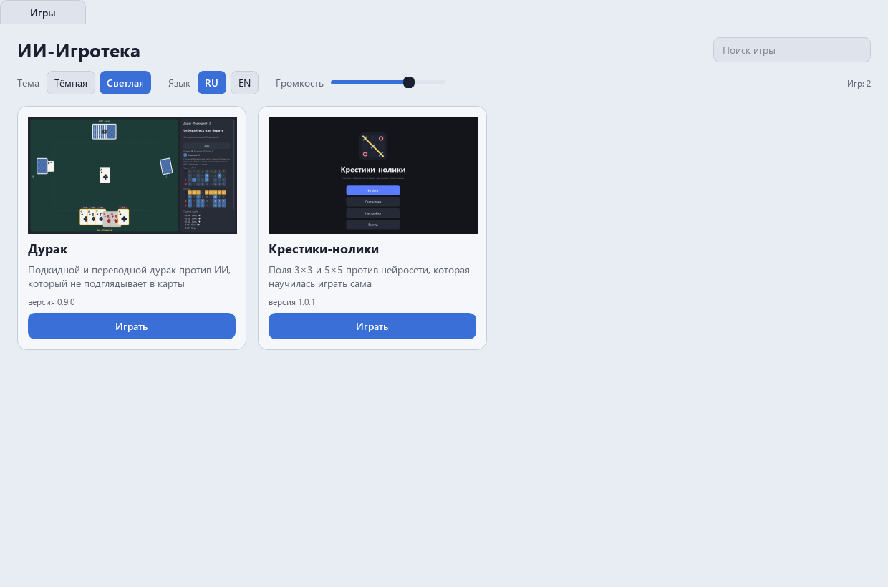

<div align="center">

# ИИ-Игротека

**Одно окно для игр против ИИ, который научился играть сам: дурак, крестики-нолики и дальше больше. Каждая игра открывается во вкладке, тема, язык и звук общие.**

[English version](README.md)

[](LICENSE)



</div>

[](https://claude.com/claude-code)
Код, тесты и документация этого проекта написаны Claude (Anthropic) в Claude Code. Идеи, проверка и решения - Алексей.

**Состояние:** версия 0.1.0, ещё не выпущена. Выпуск 1.0 - когда внутри будут все игры; пока запуск из исходников (см. «Запуск»).

Каждая игра делается в своём репозитории по одному контракту
([docs/contract.md](docs/contract.md)): пакет `game/` с `GAME_INFO` и `create_widget(ctx)`.
ИИ-Игротека - оболочка, которая собирает эти игры в одну программу.

## Что умеет

- **Вкладка «Игры»:** карточка на каждую игру - превью, описание, версия, поиск. Игра, которая
  не загрузилась, остаётся в списке с причиной, оболочка работает дальше.
- **Каждая игра во вкладке.** Можно открыть несколько; скрытая вкладка стоит на паузе, закрытая
  останавливает потоки игры за 2 секунды и освобождает память.
- **Общие настройки:** темы Paint (тёмная и светлая), русский и английский, громкость. Сменили в
  оболочке или в настройках любой игры - смена доходит до всех открытых игр.
- **Общая статистика:** на карточке игры - сколько партий, побед и лучшая серия побед, в шапке -
  сколько партий во всех играх.
- Окно открывается там, где его закрыли.
- Только Python, PySide6 и numpy. Без pygame.

## Игры

| Игра | Версия | Откуда |
|---|---|---|
| Дурак | 1.0.5 | DurakAi |
| Крестики-нолики | 1.0.1 | TicTacToeAi (пока только по-русски) |
| Камень-ножницы-бумага | 1.0.4 | RockPaperAi |
| Нейро-змейка | 2.0.0 | SnakeAi |

Остальные приходят по мере готовности: 2048, падающие блоки, шашки и шахматы, морской бой,
сапёр и другие.

## Запуск

```
pip install -r requirements.txt
python main.py                  # оболочка
python main.py --game durak     # сразу открыть игру
python main.py --list           # какие игры нашлись и почему какая-то не загрузилась
python main.py --selftest итог.txt
```

## Как игра попадает в Игротеку

```
python tools/vendor_game.py durak                   # копия игры в games/durak/
python tools/contract_check.py ../SomeGame --run    # проверка папки игры по контракту
```

Игры лежат копиями в `games/<id>/`: у каждой игры пакет называется `game`, а два пакета с
одним именем в одной программе не уживаются, поэтому при копировании импорты
переписываются. Подробно - [docs/games.md](docs/games.md).

## Сборка

```
pip install pyinstaller pillow
python build.py                 # dist/AiGameRoom, portable-архив и установщик NSIS
```

Один Python и один Qt на все игры: папка около 150 МБ, установщик около 45 МБ, сами игры -
меньше 2 МБ.

## Проверки

```
pip install -r requirements-dev.txt
python -m pytest -q             # без экрана (Qt offscreen)
python tools/mutate.py          # нарочно ломает оболочку, каждый мутант должен быть пойман
```

Каждая игра из `games/` в тестах открывается и закрывается: без ошибок, без оставшихся
виджетов и потоков, память не растёт при повторных открытиях.

## Лицензия

MIT
